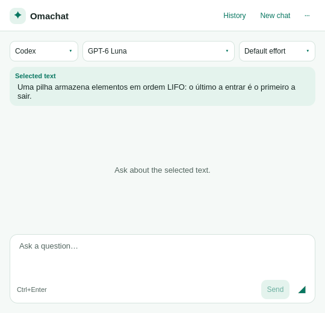

# Omachat

> **Versão atual:** `v0.2.2` · **Licença:** MIT · **Plataforma:** Omarchy (Hyprland + Qt 6 / Quickshell)



Selecione um texto no Omarchy e abra uma conversa com Codex ou Antigravity usando suas contas existentes. A janela abre na lateral, flutua sobre o desktop e pode ser movida e redimensionada pelo Hyprland.

## Uso

- Selecione texto e clique **Explicar com IA** para continuar a conversa atual, **Conversar com IA** para preparar uma pergunta, ou **Explicar em novo chat** para iniciar outra conversa. Cada pergunta guarda o trecho selecionado.
- **Super+Y** abre o chat com a seleção primária. O ícone ✦ na barra faz o mesmo.
- Escolha Codex (verde) ou Antigravity (azul) na janela clara. Os seletores se reorganizam em janelas estreitas, a partir de 280 pixels.
- Ative **Modo noturno** no menu de três pontos para usar o tema inspirado no Dracula. O Omachat lembra a escolha e a aplica à barra que aparece ao selecionar texto.
- Os modelos padrão são **GPT-6 Luna** e **Gemini 4 Hydrogen Medium**, respectivamente. O menu de modelos inclui **Modelo personalizado…** para informar um identificador manual.
- No Codex, selecione o esforço de raciocínio. **Esforço padrão** usa o nível do modelo, que é `medium` no GPT-6 Luna. No Antigravity, o nível faz parte da variante escolhida, como Hydrogen Medium.
- **Ctrl+Enter** envia; **Ctrl+N** abre uma nova conversa; **Esc** oculta a janela.
- Mova/redimensione com os controles do Hyprland (Super+arrastar com o mouse). Posição e tamanho são lembrados.
- Em terminais, segure **Shift** ao selecionar. A seleção automática requer que o aplicativo publique a seleção primária no Wayland.
- Pause a barra ou configure classes de aplicativos excluídos nas configurações do plugin Omachat do Omarchy.

## Autenticação e modelos

Instale `codex` e/ou `agy` no PATH da sessão e autentique com `codex login` ou `agy acp --login`. O menu **Entrar na conta** abre esse fluxo em um terminal. O aplicativo reutiliza a autenticação gerida pelas CLIs e não copia suas credenciais. Modelos e limites dependem da conta.

Codex lista os modelos do cache local `~/.codex/models_cache.json`. Antigravity consulta `agy models`. Use **Atualizar modelos** após entrar na conta. O contexto da conversa é reconstruído a partir das mensagens locais, permitindo mudar de provedor/modelo sem depender de uma sessão remota específica. As respostas são mostradas ao concluir cada turno.

As chamadas Codex ignoram a configuração pessoal, desativam shell, exec, apps, plugins, agentes, imagens e pesquisa web e usam sandbox somente leitura. Antigravity usa a política `strict` e regras de negação para comandos, leitura/escrita de arquivos, URLs e MCP. A aplicação não aprova pedidos de ferramentas. O objetivo é explicar/conversar, não executar tarefas no computador.

## Histórico e limites

Mensagens e seleção original são salvas em `~/.local/share/Omachat/omachat/history.json` (ou no diretório XDG equivalente), com acesso apenas pelo usuário. **Abrir pasta do histórico** mostra o local exato. Excluir uma conversa remove sua cópia do Omachat; as CLIs/provedores podem manter seus próprios registros. A seleção só é enviada após clicar em Explicar ou enviar uma mensagem. O contexto é reenviado a cada turno e conta para o uso da conta.

Seleção e mensagem: até 32 KiB de texto; contexto acumulado: até 200 mil caracteres. Se o limite for atingido, abra outra conversa. A barra some depois de seis segundos. Textos em imagem/PDF sem seleção primária não são capturados; OCR não está incluído.

## Construir, testar e instalar

Requisitos: Omarchy com Hyprland 0.56+, Quickshell, Qt 6, qmake6, make, compilador C++, Python e wl-clipboard.

```sh
./bin/build
./bin/test
OMACHAT_LIVE=1 ./bin/test liveProviders
./bin/install
```

A instalação gera um pacote Arch, instala com pacman e copia o plugin para `~/.config/omarchy/plugins/local.omachat`. Faz backup de `bindings.lua`, verifica se Super+Y está livre, adiciona a regra da janela e valida o Hyprland. Não altera `/usr/share/omarchy`. Se o Omapop também estiver ativo, ambas as barras podem aparecer; desative um dos plugins conforme sua preferência.

## Remover

Desative `local.omachat` no Omarchy, remova o bloco `-- Omachat integration` de `~/.config/hypr/bindings.lua` (as duas linhas seguintes), execute `hyprctl reload` e remova o pacote com `omarchy pkg remove omachat`. O histórico fica preservado na pasta de dados até ser removido explicitamente.

## Validação

Os testes Qt cobrem persistência/exclusão/permissões do histórico, conteúdo citado, argumentos dos provedores e CLIs simuladas. O teste opcional `liveProviders` usa contas autenticadas e envia uma pergunta curta a cada provedor. A interface também é validada com renderização Qt offscreen. O motor de seleção deriva do Omapop (MIT, Jon Kinney); tema e tradução seguem os templates de aplicativos Omarchy (MIT, David Heinemeier Hansson).

## Trabalhos futuros

- **Universalidade de provedores:** abstrair a camada de backend para suportar provedores além de Codex e Antigravity — incluindo outras CLIs de agentes (como Claude Code, OpenCode e Gemini CLI), modelos locais (Ollama / llama.cpp) e provedores customizados declarados pelo usuário — mantendo o isolamento somente leitura e sem execução automática de ferramentas.
- **Streaming de respostas:** exibir tokens incrementalmente durante a geração, reduzindo a latência percebida em respostas longas.
- **Captura e OCR opcional:** suportar explicação de trechos em imagens e PDFs sem seleção primária no Wayland.
- **Histórico pesquisável e exportável:** busca por texto nas conversas salvas e exportação em Markdown.
- **Distribuição de releases:** publicação automatizada de pacotes Arch (`.pkg.tar.zst`) e PKGBUILD para instalação direta.
